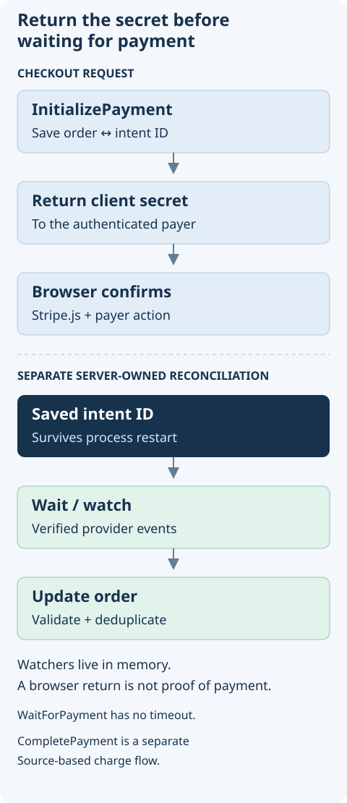

# Interface Stripe Documentation

## Overview

Create payment intents and react to their status through `@antelopejs/interface-stripe`. The package uses the official [Stripe Node.js SDK](https://github.com/stripe/stripe-node); an implementing module supplies the configured client and payment-change events.

## Choose a payment task

| Your task                           | Start here                                                               |
| ----------------------------------- | ------------------------------------------------------------------------ |
| Start a browser checkout            | [Complete payment flow](./2.payment-processing.md#complete-payment-flow) |
| Create an intent with your order ID | [InitializePayment](./2.payment-processing.md#initializepayment)         |
| Reconcile success or cancellation   | [WaitForPayment](./2.payment-processing.md#waitforpayment)               |
| React to status updates             | [Event monitoring](./3.event-monitoring.md)                              |
| Use an existing chargeable Source   | [CompletePayment](./2.payment-processing.md#completepayment)             |
| Call another Stripe API             | [GetClient](./2.payment-processing.md#getclient)                         |



Configure a Stripe implementation, test credentials, and verified webhook delivery before using these examples. This page does not process payments. Keep secrets on the server and use Stripe test mode when trying a flow.

## Installation

Install the interface as a dependency:

```bash
npm install @antelopejs/interface-stripe
```

## Exports

The interface exposes the following public API:

| Export                | Type      | Description                                                      |
| --------------------- | --------- | ---------------------------------------------------------------- |
| `GetClient`           | Function  | Returns the initialized Stripe client instance.                  |
| `InitializePayment`   | Function  | Creates a new payment intent and associates a custom payload ID. |
| `WaitForPayment`      | Function  | Waits for a payment intent to reach a terminal state.            |
| `CompletePayment`     | Function  | Completes a payment using a chargeable Stripe source.            |
| `WatchAllPayments`    | Function  | Registers a callback for all payment intent changes.             |
| `WatchPayment`        | Function  | Registers a callback for a specific payment intent's changes.    |
| `IntentChangeContext` | Interface | Context metadata attached to payment intent change events.       |

## Key Concepts

### Payment Intents

Every payment flows through the Stripe `PaymentIntent` object. The `InitializePayment` function creates a payment intent and stores a custom identifier in its `metadata.payload` field. This identifier links the Stripe payment intent back to your application-level entity (such as an order ID).

### Event Monitoring

Payment intent status changes propagate through an internal event system. `IntentChangeContext.local` distinguishes events from the current instance from forwarded cluster events. Filtering forwarded events does not deduplicate webhook redelivery; make order updates idempotent and persist enough state to reconcile after a restart.

### Terminal States

A payment intent reaches a terminal state when its status becomes either `succeeded` or `canceled`. The `WaitForPayment` function resolves on success and rejects on cancellation. Watcher callbacks registered with `WatchPayment` are automatically cleaned up once the intent reaches a terminal state.

## Documentation Sections

- [Payment Processing](./2.payment-processing.md) - Create, complete, and await payment intents.
- [Event Monitoring](./3.event-monitoring.md) - Watch payment intent changes and react to status updates.
