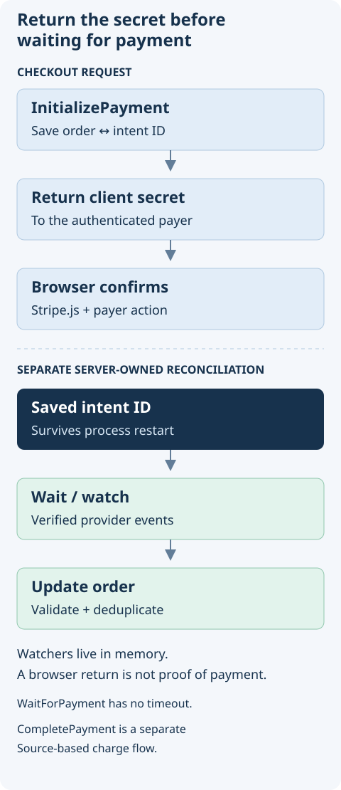

## Overview

`@antelopejs/interface-stripe` creates payment intents and reports their status to your code. The package uses the official [Stripe Node.js SDK](https://github.com/stripe/stripe-node). A module that implements the interface, such as `@antelopejs/stripe`, supplies the configured client and the payment intent events.

## Choose a payment task

| Your task                           | Start here                                                               |
| ----------------------------------- | ------------------------------------------------------------------------ |
| Start a browser checkout            | [Complete payment flow](./2.payment-processing.md#complete-payment-flow) |
| Create an intent with your order ID | [InitializePayment](./2.payment-processing.md#initializepayment)         |
| Reconcile success or cancellation   | [WaitForPayment](./2.payment-processing.md#waitforpayment)               |
| React to status updates             | [Event monitoring](./3.event-monitoring.md)                              |
| Use an existing chargeable Source   | [CompletePayment](./2.payment-processing.md#completepayment)             |
| Call another Stripe API             | [GetClient](./2.payment-processing.md#getclient)                         |

{width="480"}

Before you try these examples, configure a Stripe implementation, test credentials, and verified webhook delivery. This page does not process payments. Keep secrets on the server, and use Stripe test mode when you try a flow.

## Installation

Install the interface as a dependency:

```bash
npm install @antelopejs/interface-stripe
```

## Exports

The interface exports these functions and types:

| Export                | Type      | Description                                                            |
| --------------------- | --------- | ---------------------------------------------------------------------- |
| `GetClient`           | Function  | Returns the Stripe client that the implementing module configured.     |
| `InitializePayment`   | Function  | Creates a payment intent and stores your identifier in its metadata.   |
| `WaitForPayment`      | Function  | Waits for a payment intent to succeed or to be canceled.               |
| `CompletePayment`     | Function  | Charges a chargeable Stripe Source for the amount of a payment intent. |
| `WatchAllPayments`    | Function  | Registers a callback for every payment intent event.                   |
| `WatchPayment`        | Function  | Registers a callback for the events of one payment intent.             |
| `IntentChangeContext` | Interface | Tells a callback whether this instance received the event from Stripe. |

## Key concepts

### Payment intents

Every payment goes through a Stripe `PaymentIntent` object. `InitializePayment` creates the payment intent and stores your identifier in its `metadata.payload` field. The identifier links the payment intent to an entity in your application, such as an order ID.

### Event monitoring

The implementing module emits an event each time Stripe reports a change to a payment intent, and the watcher functions pass that event to your callbacks. `IntentChangeContext.local` is `true` when this instance received the webhook from Stripe, and `false` when another instance relayed it. Filtering out relayed events does not remove repeated webhook deliveries. Make order updates idempotent, and persist enough state to reconcile after a restart.

### Terminal states

A payment intent reaches a terminal state when its status becomes `succeeded` or `canceled`. `WaitForPayment` resolves on success and rejects on cancellation. When the intent reaches a terminal state, the interface removes the callbacks that `WatchPayment` registered for it.

## Documentation sections

- [Payment processing](./2.payment-processing.md) creates, completes, and waits for payment intents.
- [Event monitoring](./3.event-monitoring.md) watches payment intent changes and reacts to status updates.
